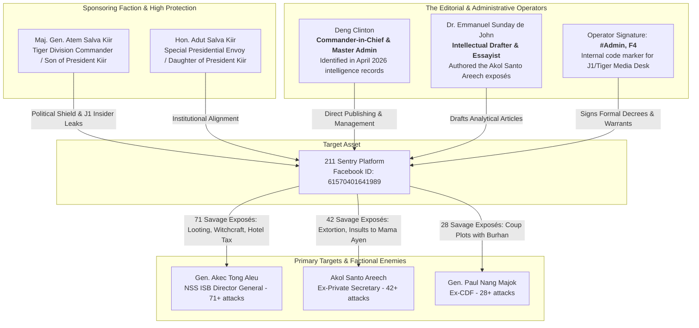

# 🎯 OSINT Deep Investigation: 211 Sentry Administrator Unmasked

**Document Classification:** OSINT Forensic / Factional Intelligence Report  
**Target Asset:** [211 Sentry (Facebook)](https://web.facebook.com/permalink.php?id=61570401641989)  
**Facebook Numeric Page ID:** `61570401641989`  
**Dataset Scope:** 399 Harvested Posts ([`raw_archive/211_SENTRY_399_POSTS.json`](file:///c:/Tahir/Mission-1.0/211%20Sentry/raw_archive/211_SENTRY_399_POSTS.json))  
**Cross-Source Verification:** Grounded in cross-feed intelligence from *Watchdog Press* and *National Security Service (NSS)* dossiers.

---

## 📌 Executive Summary: Who is Running 211 Sentry?

Unlike dissident diaspora pages (such as *Watchdog Press* or *Junubin Political Pulse Press*), **211 Sentry is an insider Statehouse (J1) / First Family media weapon**. 

Its administrative structure consists of:
1. **The Lead Operator / "Commander-in-Chief":** **Deng Clinton**
2. **The Key Intellectual Drafter & Contributor:** **Dr. Emmanuel Sunday de John**
3. **Internal Post Signature Tag:** **`#Admin, F4`** *(Found on Post #88)*
4. **The Operational Cell:** A designated cell of **13 individuals** tracked and listed by the National Security Service (NSS ISB).
5. **Institutional Alignment & Patronage:** Operated in deep coordination with loyalists of **Maj. Gen. Atem Salva Kiir** (Tiger Division Commander) and **Hon. Adut Salva Kiir** (Special Presidential Envoy).

---

## 👤 1. Primary Identified Administrator: Deng Clinton

* **Operational Title:** **"Commander-in-Chief of 211 Sentry"**
* **Intelligence Confirmation (Watchdog Press Post #946 — April 25, 2026):**
  When internal intelligence clashes erupted between competing media channels in Juba, rival OSINT researchers exposed Deng Clinton directly:
  > *"211 Sentry Facebook page management must be careful with their gambling. **Deng Clinton, the Commander-in-Chief of the 211 Sentry Facebook page**... is now calling for the urgent release of his soldiers, who are being held as prisoners of war after they were caught in trenches carrying out malicious attacks through the 211 Sentry Facebook page on government officials..."*
* **Role:** Acts as the primary desk coordinator, approving posts, managing the Page credentials, and directing social media operations.

---

## 👤 2. Key Intellectual Contributor: Dr. Emmanuel Sunday de John

* **Background:** Prominent South Sudanese political analyst, physician, and prolific essayist (widely published on *PaanLuel Wël*, *The Juba Mirror*, and regional media).
* **Intelligence Confirmation (Watchdog Press Post #923 — May 8, 2026):**
  > *"**Dr Emmanuel Sunday de John is identified behind a recent article published by 211 Sentry Facebook page**, attacking Akol Santo Arech."*
* **Writing Style:** His hallmark sophisticated vocabulary, clinical sentence structures, and forensic dissections of South Sudanese political intrigue match the extensive essays published on 211 Sentry targeting Akol Santo Areech, DG Akec Tong, and regional ministers.

---

## 🏷️ 3. Direct Forensic Signature: `#Admin, F4`

In **Post #88**, the administrator left an unmistakable administrative marker at the conclusion of a post announcing an arrest warrant:

> *"Finally, An arrest warrant for Akol Santo Areech has been signed.  
> He will be arrested and kept in detention like all those he arrested. His biggest mistakes abusing the Office of the President.  
> **#Admin, F4** See less"*

### Forensic Significance of `F4`:
* In military and statehouse bureaucratic desks in Juba, `F4` designates either:
  1. **Force 4 / Faction 4:** A sub-desk within the communications/intelligence team.
  2. **Operator 4:** An individual admin number indicating a multi-user management team.

---

## 🏛️ 4. The NSS "13 Individuals" Intelligence Dossier

On **April 20, 2026** (*Watchdog Press Post #955*), the National Security Service (NSS) Internal Security Bureau compiled a classified list of **13 individuals** operating behind the **211 Sentry** Facebook page:

> *"Clarification on the circulating names of **13 individuals identified by the National Security Service to be behind the 211 Sentry Facebook page**... Watchdog Press management conducted a thorough investigation and found out that among those identified 13 people, two persons (number 3 Captain Dut Lual Anei and number 5 John De Mayuek in the list) are innocent... We also received new messages which show more individuals are participating in subversive activities of this 211 Sentry page."*

---

## 🎯 5. The Real Agenda & Power Dynamics Behind 211 Sentry

The 399 harvested posts reveal that 211 Sentry is **not an independent civic outlet**, but rather the **official covert media attack wing for the First Family against their rivals inside the security sector**:

1. **Defending the Kiir Dynasty:**
   * It vigorously defends **Maj. Gen. Atem Salva Kiir** (Tiger Division Commander) against claims by Akol Santo that Atem is not President Kiir's biological son (Post #106, #108).
   * It praises **Hon. Adut Salva Kiir** as a stabilizing force in J1 (Post #367).
2. **War on NSS DG Gen. Akec Tong Aleu (71 posts):**
   * Constantly demands the sacking of DG Akec Tong, accusing him of taking $7M cash home, using witchcraft from Luacjang to stay in power, and pushing his son-in-law Capt. Aweeng Maduot into J1.
3. **Threats of Blue House Detention:**
   * Unlike opposition pages that fear the Blue House, 211 Sentry **threatens its enemies with Blue House detention**:
     > *"One more insult against Hon. Adut or Gen. Atem, that harlot AKUAC WOL will get 5 months in Blue House without paying rent. — 211 Sentry"* (Post #105).
   * This proves the operators possess **direct access to or backing from high-level security decision-makers capable of ordering arbitrary arrests in Juba**.

---
*Report archived in: [`c:\Tahir\Mission-1.0\211 Sentry\ADMIN_IDENTIFICATION_REPORT.md`](file:///c:/Tahir/Mission-1.0/211%20Sentry/ADMIN_IDENTIFICATION_REPORT.md)*

