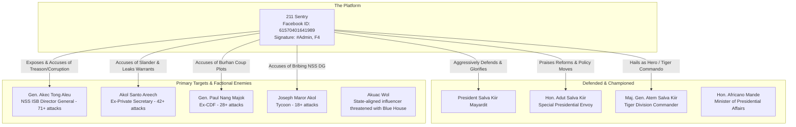

# 🎯 OSINT Target Dossier: 211 Sentry

## 1. Verified Target Overview
* **Target Entity / Page Name:** **211 Sentry**
* **Platform:** Facebook (Page)
* **Facebook Numeric Page ID:** `61570401641989`
* **Account Genesis / Age:** Active since mid-2024 / recent (Page ID prefix `6157...`)
* **Known Admin Signature:** `#Admin, F4` (Documented in Post #88)
* **Harvested Dataset:** 399 posts archived ([`raw_archive/211_SENTRY_399_POSTS.json`](file:///c:/Tahir/Mission-1.0/211%20Sentry/raw_archive/211_SENTRY_399_POSTS.json))
* **Timeline Range:** Recent 2026 posts (from current date down to ~13+ weeks ago)

---

## 2. Core Political Alignment & Editorial Bias

Unlike *Watchdog Press* (which was an anti-government diaspora channel), **211 Sentry is an insider loyalist factional attack vehicle operating on behalf of the First Family**:

---

## 3. Key Findings & Targets from Harvested Posts

1. **Hostility to NSS DG Gen. Akec Tong Aleu (71 posts / 17.8%):**
   * Accuses him of taking **$7,000,000 USD** from NSS operations budget to his house (Post #123).
   * Accuses him of practicing witchcraft and sorcery with Gok Cueibet and Luacjang magicians to prevent his removal (Post #17, #226).
   * Accuses him of taking classified intelligence files to his private home because he fears sacking (Post #60).
   * Accuses his son, Lt. Col. Tong Akec Tong, of collecting an illegal $10/bed hotel tax across Juba (Post #136).
2. **Vicious Feud with Akol Santo Areech (42 posts / 10.5%):**
   * Exposes that Akol Santo fled to Nairobi/Dubai on self-imposed exile.
   * Accuses Akol Santo of insulting First Lady Mama Ayen and claiming Gen. Atem Kiir is not President Kiir's biological son (Post #95, #106).
   * Celebrates signing of an arrest warrant for Akol Santo (Post #88: signed `#Admin, F4`).
3. **Coup Allegations against Gen. Paul Nang Majok & Sudan (28 posts / 7.0%):**
   * Claims Gen. Paul Nang and DG Akec Tong signed a secret pact with Sudan Sovereign Council (Gen. Burhan) to overthrow President Kiir (Post #184, #191).
   * Alleges Gen. Paul Nang assaulted Minister of Defense Chol Thon in his Bilpam office over a $700k dispute (Post #242).
4. **Threats to Detain Influencer Akuac Wol (Post #105):**
   * *"One more insult against Hon. Adut or Gen. Atem, that harlot AKUAC WOL will get 5 months in Blue House without paying rent. 211 Sentry"*
