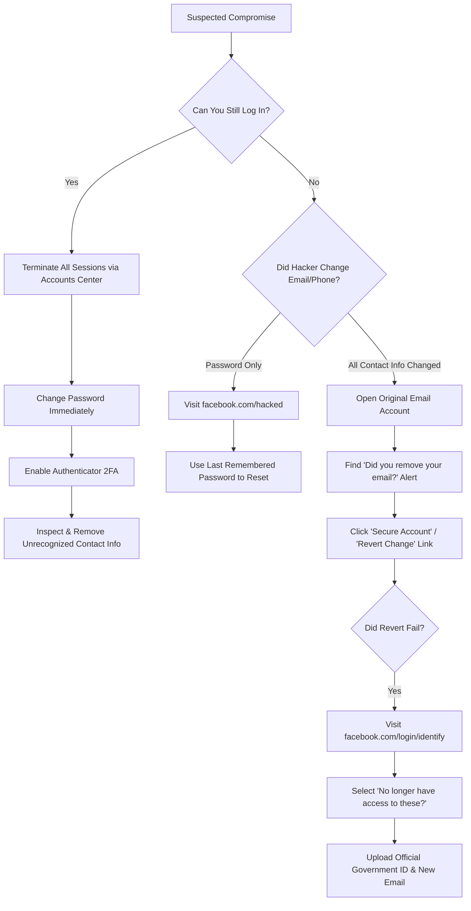

# Comprehensive Facebook Security, Architecture & Account Management Guide

A complete reference manual covering Facebook account setup, browser session architecture, deep threat models (phishing, social engineering, infostealers), Facebook's internal security engineering, an objective assessment of strengths and weaknesses, and simple plain-English explanations of 2FA and Passkeys.

---

## Table of Contents
1. [Creating an Independent Account & Meta Accounts Center](#1-creating-an-independent-account--meta-accounts-center)
2. [Web Authentication Architecture (Cookies & DevTools Deep Dive)](#2-web-authentication-architecture-cookies--devtools-deep-dive)
3. [Deep Dive: Phishing Scams & Hackers' Social Engineering Tricks](#3-deep-dive-phishing-scams--hackers-social-engineering-tricks)
   - [The Psychology of the Attack](#a-the-psychology-of-the-attack)
   - [The Top 4 Facebook Phishing Scenarios](#b-the-top-4-facebook-phishing-scenarios)
   - [Technical Tricks Used by Attackers](#c-technical-tricks-used-by-attackers)
   - [Concrete Anti-Phishing Prevention Blueprint](#d-concrete-anti-phishing-prevention-blueprint)
4. [Session Hijacking & The Impossibility of Token Guessing](#4-session-hijacking--the-impossibility-of-token-guessing)
   - [Infostealer Malware Mechanics](#a-infostealer-malware-mechanics)
   - [Mathematical Proof Against Token Guessing / Brute-Forcing](#b-mathematical-proof-against-token-guessing--brute-forcing)
5. [Confidence Assessment: Facebook's Strong Parts vs. Weak Parts](#5-confidence-assessment-facebooks-strong-parts-vs-weak-parts)
   - [The Strong Parts (Why You Can Be Confident)](#a-the-strong-parts-why-you-can-be-confident)
   - [The Weak Parts (What You Must Guard Yourself)](#b-the-weak-parts-what-you-must-guard-yourself)
   - [The "Bank Vault vs. Front Door" Reality](#c-the-bank-vault-vs-front-door-reality)
6. [Deep Dive: 2FA & Passkeys Explained in Plain English](#6-deep-dive-2fa--passkeys-explained-in-plain-english)
   - [What is 2FA? (The ATM Analogy)](#a-what-is-2fa-the-atm-analogy)
   - [The Authenticator App Magic Clock](#b-the-authenticator-app-magic-clock)
   - [What is a Passkey? (The Padlock & Key Model)](#c-what-is-a-passkey-the-padlock--key-model)
   - [Why Hackers Cannot Steal a Passkey](#d-why-hackers-cannot-steal-a-passkey)
   - [Quick Comparison: 2FA vs. Passkey](#e-quick-comparison-2fa-vs-passkey)
   - [How to Turn Them On in Facebook Right Now](#f-how-to-turn-them-on-in-facebook-right-now)
7. [Meta's Multi-Layered Defense Infrastructure](#7-metas-multi-layered-defense-infrastructure)
8. [Incident Response & Account Recovery Playbook](#8-incident-response--account-recovery-playbook)
9. [The Universal Defense Formula](#9-the-universal-defense-formula)

---

## 1. Creating an Independent Account & Meta Accounts Center

### Why Accounts Get Automatically Linked
When creating a new account that feels "attached" to an existing one, it usually occurs due to one of three mechanisms:
* **Shared Contact Information**: Using an email address or mobile phone number already registered to or associated with an existing profile.
* **Additional Profiles Feature**: Accidental creation of an "Additional Profile" (a sub-persona housed under the same primary login credentials) rather than a separate registered user.
* **Meta Accounts Center Auto-Link**: Active browser session cookies prompting the user to connect Instagram, Threads, and secondary Facebook identities under a single unified Meta Accounts Center umbrella.

### Clean Setup Protocol
1. **Isolated Session**: Open an Incognito/Private window (`Ctrl + Shift + N` on Chromium-based browsers) to prevent existing cookies from auto-associating the new registration.
2. **Dedicated Identifier**: Register using a fresh, unlinked email address (e.g., via Gmail or Outlook) or an independent phone number.
3. **Registration Execution**:
   - Navigate directly to `https://www.facebook.com`.
   - Select **"Create new account"**.
   - Input Full Name, new Email/Phone, Password, Date of Birth, and Gender.
   - Enter the 5- or 6-digit verification code delivered to the inbox/SMS.
4. **Rejecting Link Requests**: Explicitly select **"Not now"** or **"Don't connect"** when presented with Meta Accounts Center prompts to sync contacts, profiles, or avatars.

### How to Detach Existing Profiles
* **If created as an Additional Profile**:
  - Click profile picture -> Switch to the new profile -> **Settings & Privacy** > **Settings** > **Facebook information** > **Deactivation and deletion** > **Delete profile**.
* **If linked via Meta Accounts Center**:
  - **Settings & Privacy** > **Settings** > **Accounts Center** > **Accounts** > Select target account > **Remove**.

---

## 2. Web Authentication Architecture (Cookies & DevTools Deep Dive)

Modern web platforms operate statefully over stateless HTTP using browser cookies and storage mechanisms.

### Local Storage vs. Cookies
In browser developer tools (**F12** > **Application** tab):
* **Local Storage (`https://web.facebook.com`)**: Houses temporary client-side state, UI preferences, telemetry flush timestamps, and video playback cache (e.g., `Session`, `ares_last_signal_flush`, `bdz_playback_state`). **These keys do not authenticate the user.**
* **Cookies (`https://web.facebook.com`)**: The cryptographic state storage transmitted in HTTP request headers (`Cookie: ...`) to identify authenticated sessions.

```
+---------------------------------------------------------------------------------------+
|                                    Cookies Table                                      |
+-----------+-----------------------------------+----------+--------+----------+--------+
| Name      | Purpose                           | HttpOnly | Secure | SameSite | Expiry |
+-----------+-----------------------------------+----------+--------+----------+--------+
| c_user    | Numeric Facebook User ID          | No       | Yes    | None     | ~1 yr  |
| xs        | Master Session Secret Token       | Yes (✓)  | Yes    | None     | ~1 yr  |
| datr      | Long-term Browser Fingerprint     | Yes (✓)  | Yes    | None     | ~2 yrs |
| sb        | Browser Identity & Binding Secret | Yes (✓)  | Yes    | None     | ~2 yrs |
| fr        | Encrypted Tracking/Ad Cookie      | Yes (✓)  | Yes    | None     | ~3 mos |
+-----------+-----------------------------------+----------+--------+----------+--------+
```

### Key Security Flags Explained
1. **`HttpOnly` (✓)**: Prevents client-side scripts (`document.cookie` in JavaScript) from accessing the cookie. This serves as the primary barrier against Cross-Site Scripting (XSS) attacks stealing credentials.
2. **`Secure` (✓)**: Enforces that the cookie is transmitted strictly across TLS/HTTPS encrypted connections, never plain text HTTP.
3. **Session Invalidation**: Initiating a formal **Log Out** sends a server-side termination request, causing Meta's infrastructure to permanently invalidate that specific `xs` token across their clusters.

---

## 3. Deep Dive: Phishing Scams & Hackers' Social Engineering Tricks

Phishing does not attack Facebook’s computers—it attacks **human psychology**. Because hackers cannot break Facebook's algorithms, they spend 100% of their effort manipulating users into giving up their credentials willingly.

### A. The Psychology of the Attack
Hackers rely on three emotional triggers:
1. **Panic & Fear**: *"Your account will be deleted in 24 hours."*
2. **Curiosity & Shock**: *"OMG look who died!"* or *"Is that you in this leaked video?"*
3. **Ego & Opportunity**: *"You are approved for the Meta Verified badge."*

When adrenaline spikes, people skip verification and type passwords automatically.

---

### B. The Top 4 Facebook Phishing Scenarios

#### 1. The "Copyright & Community Standards Violation" Appeal
* **The Lure**: You receive an email, a tagged post, or a Messenger alert from a fake profile named *"Meta Community Support"* or *"Facebook Copyright Department"*.
* **The Message**: Claims you violated intellectual property rights and gives you 24 hours to "submit an appeal" via an external link.
* **The Reality**: Meta **never** conducts official copyright or account disputes via public tags or direct Messenger chats.

#### 2. The "Is This You in the Video?" Friend Scam
* **The Lure**: A direct message from a real friend whose account was already compromised: *"Omg is this you? 😱 [short-link]"*.
* **The Trap**: Clicking the link opens a counterfeit Facebook login page claiming you must *"Re-enter your password to prove you are over 18 and view the video."*

#### 3. Fake Ad Account Suspension (Targeting Page Owners)
* **The Lure**: Phony invoice or billing error alerts sent to business admins claiming ad campaigns are paused.
* **The Trap**: Directs users to a credential-harvesting portal targeting Facebook Business Manager privileges.

#### 4. The 2FA Social Bypass ("Send Me the Code")
* **The Lure**: An attacker attempts to reset your password and sends you a message: *"Hey! I'm locked out of my account and Facebook told me to choose a trusted friend to receive my code. Can you send me the 6 digits you just received?"*
* **The Trap**: The 6-digit SMS code was actually generated by the hacker attempting to reset **your** password.

---

### C. Technical Tricks Used by Attackers

1. **Lookalike & Typosquatting Domains:**
   Attackers register domains designed to deceive the human eye:
   * `facebook-case-appeal-portal.com`
   * `meta-verified-badge-support.net`
   * `faceb00k.com` (using a zero or Cyrillic characters)
   *(None of these are `facebook.com` or `meta.com`.)*

2. **Adversary-in-the-Middle (AiTM) Reverse Proxies:**
   Instead of just saving your password, advanced phishing kits (like Evilginx) sit transparently between you and the real Facebook:
   * You type your password into the fake site.
   * The fake site passes it to the real Facebook in real-time.
   * Real Facebook asks for your 2FA code.
   * The fake site prompts you for your 2FA code and sends it to Facebook.
   * Facebook sends back the **`xs` session cookie**.
   * The attacker intercepts and saves your session cookie before redirecting you to your real feed.

3. **Malicious OAuth Permissions:**
   Shady online quizzes ("Find your celebrity twin", "See who viewed your profile") asking you to *"Log in with Facebook"*. Once approved, these apps can request read/write permissions to post on your wall or access your profile data.

---

### D. Concrete Anti-Phishing Prevention Blueprint

* **1. Check Facebook’s Official Email Log:**
  Never trust an email claiming to be from Facebook. Open Facebook directly and go to:
  > **Settings & Privacy** > **Accounts Center** > **Password and security** > **Recent emails**
  
  Facebook maintains a tamper-proof record of every security email sent to you in the last 14 days. If an email in your inbox isn't on that list, **it is a 100% confirmed fake.**
* **2. Use a Password Manager as an Anti-Phishing Shield:**
  Password managers (Bitwarden, 1Password, Chrome) match credentials to the exact cryptographic domain. If you land on `facebook-support-appeal.com`, the manager **will not autofill**, immediately alerting you to the fake site.
* **3. Understand Link Sandboxing:**
  Clicking a link in a modern browser **does not automatically hack you**. The link is harmless until you:
  - Enter credentials into a form (Phishing).
  - Download and execute an attachment/file (Malware).
  If you ever click a suspicious link by mistake, simply **close the browser tab immediately**.

---

## 4. Session Hijacking & The Impossibility of Token Guessing

### A. Infostealer Malware Mechanics
* **The Risk**: Infostealer malware (RedLine, Vidar, Lumma) running on a compromised PC extracts the browser's SQLite cookie file directly from the hard drive, bypassing passwords and 2FA.
* **Infection Sources**: Infostealers do not appear by magic. Over 95% originate from:
  - Cracked software or game activation scripts ("free" Photoshop, Office KMS tools).
  - Game cheats, aimbots, and mod menus.
  - Deceptive executable attachments (`.exe`, `.scr`, `.bat`, or password-locked `.zip` archives).

### B. Mathematical Proof Against Token Guessing / Brute-Forcing
A common concern is whether hackers can write automated scripts to predict or guess valid Facebook session tokens. This is mathematically and practically impossible:

1. **Cryptographic Entropy**:
   - Facebook's `xs` tokens feature **128 to 256 bits of entropy** generated via CSPRNG (Cryptographically Secure Pseudorandom Number Generators).
   - $2^{128} \approx 3.4 \times 10^{38}$ combinations.
   - This number is **millions of times greater than every grain of sand on every beach on Earth**.
   - Testing 1 billion guesses per second with a supercomputer would take billions of years to encounter a single valid cookie.
2. **WAF & Rate Limiting**:
   - Meta’s Web Application Firewalls (WAF) monitor connection velocities.
   - Any IP sending repeated invalid session tokens is instantly rate-limited (HTTP 429), blocked, or served insurmountable CAPTCHA challenges within 5–10 requests.

---

## 5. Confidence Assessment: Facebook's Strong Parts vs. Weak Parts

Understanding both sides of Facebook's security architecture gives you complete realistic confidence:

### A. The Strong Parts (Why You Can Be Confident)
* **Enterprise Cryptography**: Passwords are protected using memory-hard hashing algorithms (Argon2 / Scrypt) coupled with secret "peppers" stored inside physical **Hardware Security Modules (HSMs)**. Even if hackers stole Facebook's complete database, passwords cannot be cracked offline.
* **AI Anomaly Detection (Sigma)**: Facebook tracks over 1,000 telemetry signals per request. If an attacker in another country attempts to log in with your correct password, the AI flags the geographic and hardware anomaly and freezes the session behind a verification checkpoint.
* **Phishing-Proof Passkey Support (FIDO2 / WebAuthn)**: Meta natively supports hardware security keys (YubiKey) and Passkeys. These use public-key cryptography bound to the authentic domain, rendering traditional phishing attacks powerless.
* **Automatic Dark-Web Scanning**: Meta continuously cross-references account credentials against public leaks on hacker forums. If your password appears in an external breach, Facebook automatically locks the profile and forces a reset.

---

### B. The Weak Parts (What You Must Guard Yourself)
* **Zero Human Customer Support (Critical Weakness)**: With 3 billion users, Meta has virtually no direct human customer support for standard accounts. If you get locked out or tricked into giving away your account, automated bots handle your recovery. **Prevention is your only true safety net.**
* **Local Session Cookie Exposure**: Web applications cannot prevent session cookie exfiltration if malicious software runs locally on your PC with user permissions.
* **Meta Accounts Center Cascade Effect**: Unifying Facebook, Instagram, and Threads under one Accounts Center means a weak password on an old, forgotten Instagram account can be used as a pivot point to compromise Facebook.
* **Legacy SMS 2FA Support**: SMS verification codes are vulnerable to cellular SIM-swapping attacks.

---

### C. The "Bank Vault vs. Front Door" Reality
Think of Facebook as a **high-security bank vault**:
* The vault walls (Facebook's backend servers, encryption, firewalls) are impenetrable to standard hackers.
* Hackers don't bother attacking the vault walls. Instead, they try to **trick you into handing over the key** (phishing) or **break into your house to steal your saved key** (malware).
* **If you don't give away the key and don't invite malware in, your account is completely safe.**

---

## 6. Deep Dive: 2FA & Passkeys Explained in Plain English

### A. What is 2FA? (The ATM Analogy)
Think of **Two-Factor Authentication (2FA)** exactly like an **ATM machine**:
To withdraw money, you need **two separate things**:
1. **Something you have:** Your physical plastic ATM card.
2. **Something you know:** Your 4-digit secret PIN code.

If a thief finds your PIN written down, they **cannot get your money** without the card. If they steal your card, they **cannot get your money** without the PIN.

On Facebook, 2FA applies this exact rule:
* **Factor 1 (Something you know):** Your password.
* **Factor 2 (Something you have):** Your physical smartphone generating a temporary code.

Even if an attacker halfway across the world buys your password in a data leak, **they are stopped at the door** because they don't have your physical phone.

---

### B. The Authenticator App "Magic Clock"
You don't need text messages or cell phone reception for 2FA. Apps like **Google Authenticator** or **Microsoft Authenticator** run completely offline:

1. During initial setup, Facebook displays a **QR code**.
2. Scanning the QR code shares a private mathematical formula between your phone and Facebook.
3. Every **30 seconds**, both your phone and Facebook calculate that formula using the **current second on the world clock**.
4. Both generate the exact same 6-digit number (e.g., `519 284`).
5. When you log in, Facebook checks its clock: *"My clock shows 519 284 right now too! Access granted."*

> **Why it beats SMS text messages:** Hackers can steal your phone number by calling your carrier (a **SIM Swap**). But an Authenticator App does not use phone numbers or cellular networks—its secret key is permanently locked inside your phone's physical hardware.

---

### C. What is a Passkey? (The Padlock & Key Model)
A **Passkey** is the modern replacement for passwords created by Apple, Google, and Microsoft to eliminate passwords entirely.

#### The Problem with Passwords:
Normally, you and Facebook share a secret word (like `SecretPass123!`). Every time you log in, you send that secret word across the internet. If you type it on a fake phishing site, the hacker now has it.

#### How a Passkey Fixes This (The Padlock Analogy):
With a Passkey, **you never send a secret word across the internet ever again**.

```
Your Phone (Secure Hardware Chip)                Facebook's Servers
┌────────────────────────────────┐              ┌────────────────────────────────┐
│  PRIVATE KEY (Your Physical Key)│              │  PUBLIC KEY (Your Padlock)     │
│  Locked inside device chip     │              │  Stored safely on Facebook     │
└───────────────┬────────────────┘              └───────────────┬────────────────┘
                │                                               │
                │        1. Facebook sends the locked Padlock   │
                │<──────────────────────────────────────────────┤
                │                                               │
                │  2. You touch your Fingerprint / Face ID.     │
                │     Phone unlocks the Padlock with the key.   │
                │                                               │
                │        3. Sends back the UNLOCKED Padlock     │
                ├──────────────────────────────────────────────>│
                │                                               │
                │                                4. Verified! Logged in
```

1. **The Padlock (Public):** Facebook keeps an open padlock labeled with your account name.
2. **The Key (Private):** Your phone creates a unique digital key locked inside your device's biometric security chip. **This key never leaves your device.**
3. **Logging in:** Facebook sends the locked padlock. You tap your **Fingerprint** or use **Face ID**. Your device unlocks the padlock and sends it back. Facebook confirms it is open and logs you in.

---

### D. Why Hackers Cannot Steal a Passkey

1. **There is no password to steal:**
   An attacker cannot brute-force, guess, or leak a password because **no password exists**.
2. **100% Phishing-Proof (Domain Binding):**
   * If a hacker tricks you into visiting `www.facebook-scam-portal.com` and prompts you for your passkey:
   * Your phone reads the domain name in the address bar.
   * Your phone says: *"This key belongs to `facebook.com`, NOT this fake site."*
   * Your phone **refuses to unlock the padlock**. The fake website receives nothing.

---

### E. Quick Comparison: 2FA vs. Passkey

| Feature | Password + Authenticator 2FA | Passkey (FIDO2 / Biometrics) |
| :--- | :--- | :--- |
| **How you log in** | Type password + enter 6-digit rotating code | Touch Fingerprint, Face ID, or Windows Hello |
| **Passwords needed?** | Yes, you still have a password | **No password exists** |
| **Protected against data breaches?** | ✅ Yes (hacker lacks the 6-digit code) | ✅ Yes (no password to leak) |
| **Protected against phishing websites?** | ⚠️ Can be tricked if you type the 30s code into an AiTM proxy | ✅ **100% Phishing-Proof (Hardware refuses fake domains)** |
| **Protected against SIM-Swapping?** | ✅ Yes (runs offline without SMS) | ✅ Yes (locked to physical hardware) |

---

### F. How to Turn Them On in Facebook Right Now

1. Open Facebook and go to **Settings & Privacy** > **Accounts Center**.
2. Click or tap **Password and security**.
3. Under *Login & recovery*, configure both:
   * **Two-factor authentication:** Select your profile, choose **Authentication App**, and scan the QR code using Google Authenticator or Bitwarden.
   * **Passkeys:** Click **Passkeys**, select **Add a Passkey**, and confirm with your device's fingerprint, Face ID, or PIN.

---

## 7. Meta's Multi-Layered Defense Infrastructure

```
                       [ Incoming Internet Traffic ]
                                     │
                     ┌───────────────▼───────────────┐
  LAYER 1: PERIMETER │  Anycast Edge & Custom WAF    │ (Proxygen C++ Stack, DDoS Absorption)
                     └───────────────┬───────────────┘
                                     │
                     ┌───────────────▼───────────────┐
  LAYER 2: RISK AI   │  The "Sigma" Real-Time Engine │ (Evaluates 1,000+ signals in ms)
                     └───────────────┬───────────────┘
                                     │
                     ┌───────────────▼───────────────┐
  LAYER 3: AUTH      │  Cryptographic HSM Pipeline   │ (Argon2 Hashing + Pepper HSM)
                     └───────────────┬───────────────┘
                                     │
                     ┌───────────────▼───────────────┐
  LAYER 4: APP SEC   │  React XSS Defense & CSRF     │ (fb_dtsg tokens & Ent Object Rules)
                     └───────────────┬───────────────┘
                                     │
                     ┌───────────────▼───────────────┐
  LAYER 5: PRIVACY   │  End-to-End Encryption        │ (Signal Protocol & Double Ratchet)
                     └───────────────┬───────────────┘
                                     │
                     ┌───────────────▼───────────────┐
  LAYER 6: AUDITING  │  Zoncolan & Sapienz Bots      │ (Continuous Static Code Analysis)
                     └───────────────────────────────┘
```

---

## 8. Incident Response & Account Recovery Playbook



### Action Protocols:
1. **Always Use a Trusted Device**: Conduct recovery using a computer or phone and Wi-Fi connection previously recognized by Facebook's fraud filters.
2. **The "Revert" Email**: When an email is changed, Facebook always sends an emergency alert to the original address containing a one-click security freeze link.
3. **Identity Verification**: If locked out of email, phone, and 2FA, use the identity verification workflow requiring an official government-issued ID (Passport, Driver's License) and a new, clean email address.

---

## 9. The Universal Defense Formula

To make your Facebook account virtually unhackable, follow this 4-step formula:

1. **Deploy a Password Manager**:
   - Enforce long, random, unique passwords per platform.
   - Leverage automatic domain matching to block 100% of standard phishing attempts.
2. **Switch to Authenticator App 2FA or Passkeys**:
   - Follow the steps in Section 6 to turn on an Authenticator App and a Passkey.
3. **Fortify Your Primary Email Account**:
   - The master key to Facebook is your recovery email. Secure your email account with unique passwords and 2FA.
4. **Practice Clean Software Hygiene**:
   - Keep Windows Defender active.
   - Never run cracked software, cheats, or untrusted executables.
   - Remember the link rule: A link cannot hack your browser unless you type credentials or run an executable file.
